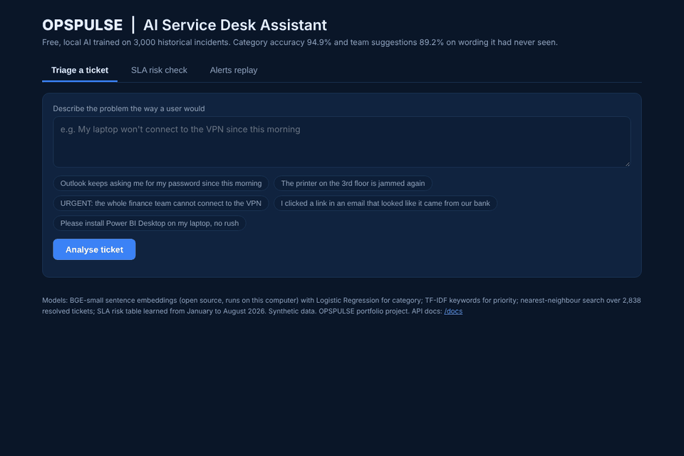
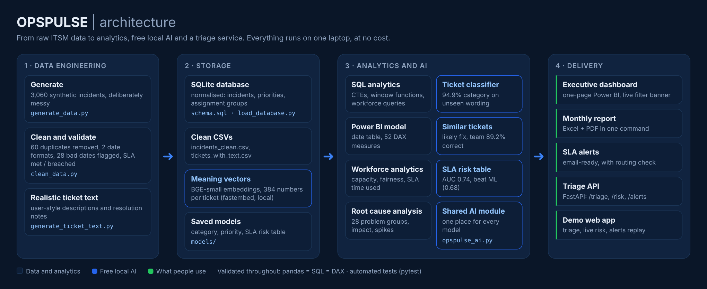
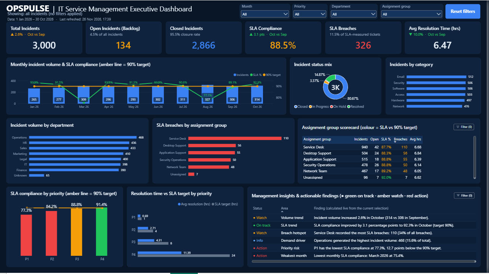
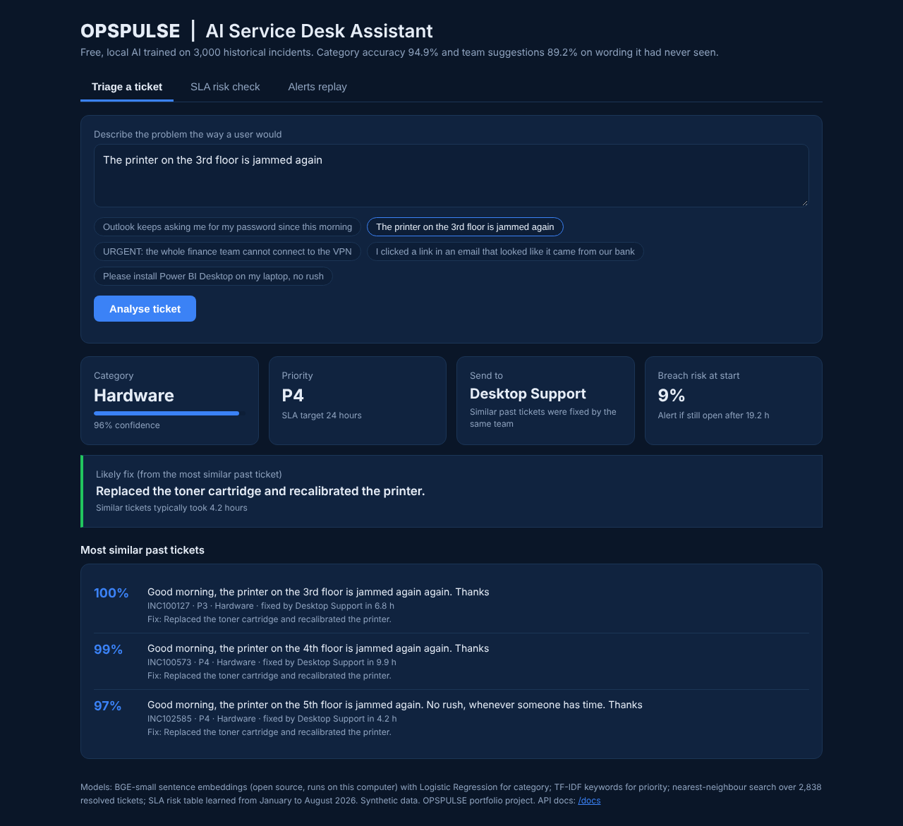
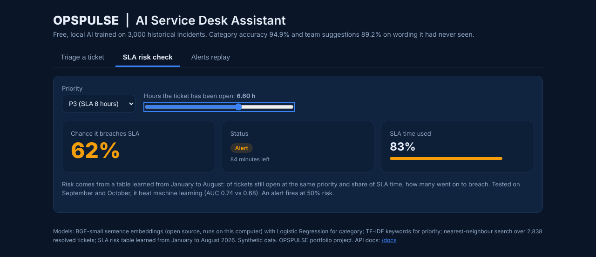
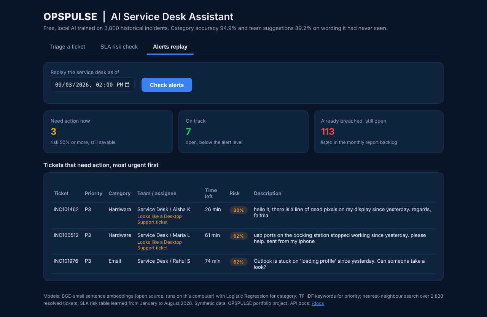

# OPSPULSE
### AI-Powered IT Operations Intelligence Platform

**Turning ITSM data into operational intelligence through analytics, automation and AI.**




*The demo app: triage a ticket, watch SLA risk change live, replay alerts. Free models, running locally.*

---

## 1. Overview

OPSPULSE is an end-to-end IT service management (ITSM) portfolio project. It takes raw, messy incident data and turns
it into a validated data pipeline, SQL analytics, an executive Power BI dashboard, an automated monthly report, and
free AI that triages tickets, suggests fixes, finds recurring problems and warns before SLAs breach.

Everything runs on one laptop at no cost. All data is synthetic (generated by the project); no real company data is used.

## 2. Business problem

IT service desks handle large volumes of incidents. Common problems:

- Limited visibility into incident trends and SLA performance
- SLA breaches noticed only after they happen
- Tickets sent to the wrong team, and uneven workload between teams
- Hours of manual monthly reporting
- Recurring problems hidden among individual incidents

## 3. What OPSPULSE does

| Module | Status | What it delivers |
|---|---|---|
| Incident intelligence | ✅ | Clean pipeline, SQL analytics, trends by month, priority, team and category |
| SLA monitoring | ✅ | Executive dashboard, SLA breach analysis, early-warning risk and alerts |
| Workforce analytics | ✅ | Team capacity, fairness of workload, technician scorecard |
| Automated reporting | ✅ | Monthly Excel + PDF management report in one command |
| AI incident assistant | ✅ | Category, priority and team for any ticket, with similar past tickets and the likely fix |
| Root cause intelligence | ✅ | Recurring problem groups ranked by impact; systemic vs one-off causes |
| Workflow automation | ✅ | Email-ready SLA alerts with a routing check; triage API |
| Knowledge assistant (LLM) | Planned | Needs a paid LLM API; designed to plug into the same AI module |

## 4. Architecture



## 5. Results at a glance

**Operations (3,000 incidents, Jan to Oct 2026)**

| Metric | Value |
|---|---|
| SLA compliance | 88.5% against a 90% target (2,838 tickets with an SLA result) |
| SLA breaches | 326; worst in March (75.4% SLA) and August (77.1%) |
| Weakest priority | P1 at 77.3% |
| Breach hotspot | Service Desk, 110 breaches (34%) |
| Team capacity | Service Desk technicians carry 313 tickets each, 1.9x Desktop Support |
| Open backlog | 123 of 134 open tickets older than 30 days |
| Root cause | SLA fell in 25 of 28 problem groups in March and August, so the cause is systemic (staffing or process) |

**AI (tested on ticket wording the models had never seen)**

| Task | Result |
|---|---|
| Ticket category | Keyword ML 60.2% · free semantic AI zero-shot 84.6% · semantic AI trained **94.9%** |
| Team suggestion from similar tickets | **89.2%** correct, better than the original human routing (87.2%) |
| Misrouted tickets caught | all 80 in the test set (76% of flags correct) |
| Similar-ticket fix applies | closest past ticket is the same problem 76.7% of the time |
| SLA breach early warning | simple risk table AUC **0.74** beat machine learning (0.68) on unseen months; warned about all 55 breaches in Sep and Oct |

**Decisions worth noting**
- Keyword ML scored 100% on familiar wording but 60% on new wording, so the honest test holds out sentence patterns.
- For priority, keywords beat the semantic model (70.3% vs 58.6%), so the design is hybrid.
- For SLA risk, machine learning did not beat a simple table, so the explainable table is used.
- A reviewer read a cross-filtered dashboard as inconsistent numbers, so a live "filtered view" banner was added.

## 6. Executive dashboard



One-page Power BI dashboard: KPI cards with month-over-month change, volume vs SLA against a 90% target, department
and team analysis, SLA and resolution by priority, and six management insights written by DAX with traffic-light
status. Every figure was cross-checked against independent SQL. Details: [docs/powerbi_dashboard_guide.md](docs/powerbi_dashboard_guide.md).

## 7. Demo app and API

Run `uvicorn api:app --app-dir src --port 8000` and open http://127.0.0.1:8000 (API documentation at `/docs`).



| SLA risk check | Alerts replay |
|---|---|
|  |  |

API endpoints: `POST /triage` (any ticket text), `POST /risk` (priority + hours open), `GET /alerts?as_of=...`, `GET /health`.
Screenshots and GIF are from a test run.

## 8. Technology stack

| Area | Tools |
|---|---|
| Data engineering | Python 3.12, pandas, NumPy, SQLite, SQL (CTEs, window functions) |
| Business intelligence | Power BI Desktop, DAX, Power BI Project (PBIP) files in Git |
| Reporting | openpyxl (Excel), Matplotlib (charts and PDF) |
| Machine learning | scikit-learn (TF-IDF, Logistic Regression, K-Means, gradient boosting) |
| Free local AI | fastembed with BGE-small sentence embeddings (open source, no API key) |
| Serving | FastAPI, Uvicorn, HTML/CSS/JavaScript |
| Quality | pytest, validation of every KPI against SQL |
| Tooling | Git, GitHub, VS Code |

## 9. How to run

```bash
python -m venv .venv
source .venv/Scripts/activate        # Windows Git Bash
pip install -r requirements.txt

# data pipeline and analytics
python src/generate_data.py
python src/clean_data.py
python src/load_database.py
python src/run_query.py sql/analytics_advanced.sql
python src/export_for_powerbi.py
python src/generate_report.py                  # monthly report (latest month); --month 2026-08 for another
python src/workforce_analytics.py

# AI (the first run downloads a ~70 MB open-source model)
python src/generate_ticket_text.py
python src/train_classifier.py
python src/semantic_classifier.py
python src/similar_tickets.py "outlook keeps asking for my password"
python src/root_cause_analysis.py
python src/sla_risk_prediction.py
python src/sla_alerts.py --as-of "2026-09-03 14:00"

# tests, API and demo app
python -m pytest -q
uvicorn api:app --app-dir src --port 8000
```

Open `reports/opspulse_executive_dashboard_v2.pbix` (or the `.pbip` project) in Power BI Desktop.

## 10. Pipeline, step by step

| Stage | Script / file | What it does |
|---|---|---|
| 1. Generate data | `src/generate_data.py` | 3,060 synthetic incidents with deliberate data-quality problems |
| 2. Explore | `src/explore_data.py` | Shape, types and missing values |
| 3. Clean | `src/clean_data.py` | Removes 60 duplicates, standardises priorities, parses both date formats, flags 28 invalid dates, adds resolution hours and SLA met |
| 4. Load | `sql/schema.sql`, `src/load_database.py` | Normalised SQLite database |
| 5. Analyse | `sql/analytics_basic.sql`, `sql/analytics_advanced.sql`, `src/run_query.py` | GROUP BY, JOINs, CTEs, LAG, running totals, RANK, ROW_NUMBER, HAVING |
| 6. Export | `src/export_for_powerbi.py` | Power BI source workbook |
| 7. Visualise | `reports/opspulse_executive_dashboard_v2.pbix` (+ `.pbip`) | Data model, date table, 52 DAX measures, executive dashboard |
| 8. Report | `src/generate_report.py` | Monthly Excel workbook and 2-page PDF with traffic-light findings |
| 9. AI data | `src/generate_ticket_text.py` | Realistic ticket text and resolution notes; 12.3% of tickets misrouted |
| 10. AI classifier | `src/train_classifier.py`, `src/semantic_classifier.py` | Keyword ML vs free semantic AI for category, priority and team |
| 11. Workforce | `sql/workforce.sql`, `src/workforce_analytics.py` | Technician scorecard, workload fairness, team capacity |
| 12. Similar tickets | `src/similar_tickets.py` | Most similar past tickets, suggested team, likely fix, typical time |
| 13. Root cause | `src/root_cause_analysis.py` | 28 problem groups by meaning, impact ranking, spike and systemic checks |
| 14. SLA risk | `src/sla_risk_prediction.py` | Early-warning risk table tested on unseen months |
| 15. Alerts and API | `src/opspulse_ai.py`, `src/sla_alerts.py`, `src/api.py`, `tests/` | Shared AI module, email-ready alerts, FastAPI service, automated tests |
| 16. Demo app | `src/static/index.html` | One-page web app on top of the API |

## 11. Project structure

```text
opspulse-it-operations-platform/
├── data/
│   ├── raw/                 incidents_raw.csv (messy on purpose)
│   └── processed/           incidents_clean.csv, opspulse.db, tickets_with_text.csv, test sets
├── sql/                     schema, analytics and workforce queries
├── src/                     pipeline, reporting, AI, API (+ static/ for the demo app)
├── models/                  trained models and the SLA risk table
├── reports/
│   ├── output/              monthly Excel + PDF reports
│   ├── ai/  workforce/  rca/  sla_risk/  alerts/  demo/
│   ├── opspulse_executive_dashboard_v2.pbix, .pbip project, screenshots
│   └── backup/              earlier dashboard versions
├── docs/                    project journal, flowchart, architecture, Power BI guide, LinkedIn post
├── tests/                   pytest checks
├── requirements.txt
└── README.md
```

## 12. Roadmap

- [x] Incident data foundation, cleaning and validation
- [x] SQL analytics engine
- [x] SLA monitoring and Power BI dashboard
- [x] Incident trend detection
- [x] Automated reporting
- [x] Technician workload analysis
- [x] AI incident classification
- [x] AI resolution recommendations (similar tickets)
- [x] Root cause analysis
- [x] SLA risk prediction and notifications
- [x] REST API, automated tests and demo app
- [ ] AI ticket summarisation (LLM, paid API)
- [ ] Knowledge-base assistant (LLM + retrieval, paid API)
- [ ] AI operations chat assistant (LLM, paid API)
- [ ] Cloud deployment

## 13. Documents

- [Project journal](docs/project_journal.md): every step, problems fixed, key numbers, concepts and interview talking points
- [Project flowchart](docs/project_flowchart.html): the whole build on one page (download and open in a browser)
- [Power BI guide](docs/powerbi_dashboard_guide.md): data model, all DAX measures and the validation report
- [Architecture](docs/architecture.png)

## 14. Data privacy

All data is synthetic. Patterns such as the March and August SLA dips were deliberately built into the generator so
the analytics have something real to find; they are not findings about any real organisation. AI suggestions are
decision support and are validated before being treated as reliable.

---

**OPSPULSE: making IT operations more intelligent.**
