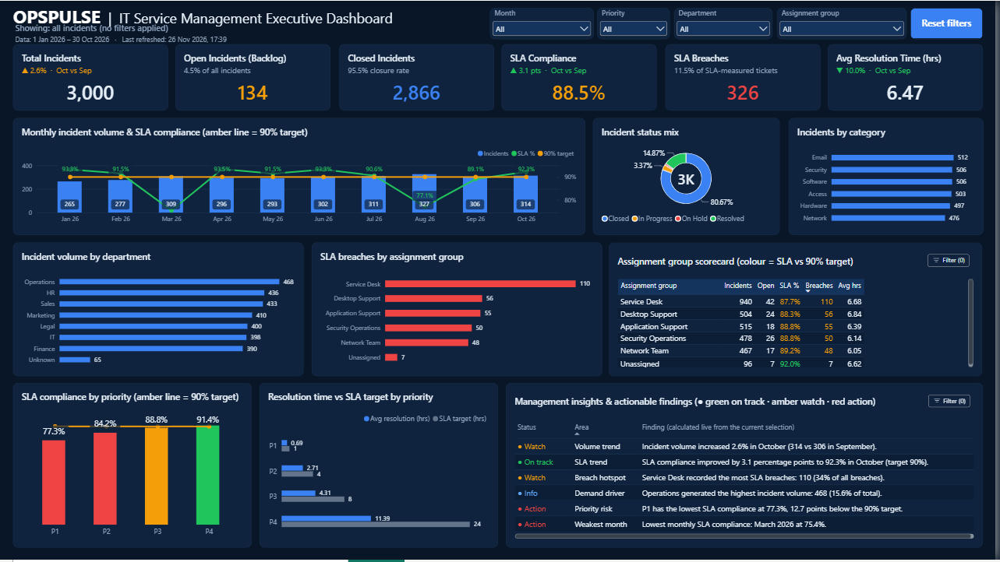

# OPSPULSE — Power BI Executive Dashboard Guide

One consolidated, single-page ITSM executive dashboard built on the OPSPULSE incident data
(3,000 incidents, Jan–Oct 2026).

## 1. Files

| File | What it is |
|---|---|
| `reports/opspulse_executive_dashboard_v2.pbix` | **Final dashboard** (with the audit fixes), single file, open in Power BI Desktop |
| `reports/opspulse_executive_dashboard.pbip` (+ `.Report`, `.SemanticModel` folders) | Same final report as a Power BI Project: model (TMDL), pages and visuals as text files, Git-friendly |
| `reports/opspulse_executive_dashboard.png` | Screenshot of the final dashboard, no filters |
| `reports/opspulse_dashboard_filtered_example.png` | Screenshot with Security Operations selected, showing the filtered-view banner |
| `reports/backup/opspulse_executive_dashboard_v1.pbix` | First executive version, before the audit fixes |
| `reports/backup/opspulse_dashboard_one_page_draft.pbix` | The earlier one-page draft (white theme) |
| `reports/backup/opspulse_dashboard_BACKUP_before_upgrade.pbix` | Untouched copy taken before the executive redesign |
| `reports/opspulse_dashboard_data.xlsx` | Data source (created by `src/export_for_powerbi.py`) |
| `reports/_old_visuals_backup/` | Old visual definitions moved aside during the rebuild. Safe to delete |

## 2. Page layout (one page, 1920 × 1080)

| Section | Visuals |
|---|---|
| Header | Title · **live filter line** ("Showing: all incidents", or amber "FILTERED VIEW → Group: Security Operations (478 incidents)" whenever a slicer or a clicked chart element is filtering the page) · data period and last-refresh timestamp · slicers: Month, Priority, Department, Assignment group · **Reset filters** button (built-in "Clear all slicers" action) |
| 1. Executive KPI cards | Total Incidents · Open Incidents (backlog) · Closed Incidents · SLA Compliance · SLA Breaches · Avg Resolution Time. Each card has a live sub-line (month-over-month change or a supporting ratio) |
| 2. Monthly trends | Column + line combo: incident volume (columns), SLA % (green line), 90% target (amber line) · Incident status mix (donut) · Incidents by category |
| 3. Department and group analysis | Incident volume by department · SLA breaches by assignment group (red) · Assignment group scorecard (incidents, open, SLA % colour-coded, breaches, avg hrs) |
| 4. SLA and resolution performance | SLA compliance by priority (red / amber / green against the 90% target) · Average resolution time vs SLA target hours by priority |
| 5. Management insights | Six findings written by DAX from the current selection: volume trend, SLA trend, breach hotspot, demand driver, priority risk, weakest month. Each has a status: ● On track (green), ● Watch (amber), ● Action (red), ● Info (blue) |

**Colour system.** Navy background (#0A1628) and cards (#10233F). Blue for volume, green for SLA met or improving,
red for breaches or below target, amber for warnings, target lines and backlog. Muted grey-blue for supporting text.
The theme is a custom report theme: `StaticResources/RegisteredResources/OpsPulseExec.json`.

**SLA status colour rule.** Green when SLA % ≥ 90%, amber when 85–90%, red when below 85%. Used by the SLA Compliance KPI,
the SLA-by-priority bars, the scorecard's SLA % and Breaches columns, and the insight statuses.

**Insight status rules.** Volume trend: On track if volume fell, Watch if it rose up to 10%, Action if it rose more than 10%.
SLA trend, breach hotspot (that group's SLA %), priority risk and weakest month: the SLA colour rule above. Demand driver: Info.

**Interactivity.** All visuals cross-filter each other. The four slicers filter the whole page. Reset filters clears them
(in Desktop use Ctrl+click; in the Power BI Service a normal click). No drill-through or tooltip pages were added, to keep it to one page.

## 3. Data model

| Table | Type | Key columns | Notes |
|---|---|---|---|
| Incidents | Fact, imported from Excel | incident_id, opened_at, resolved_at, opened_date, priority, assignment_group, caller_department, category, state, sla_met, resolution_hours, is_open | 3,000 rows, one per incident |
| Priorities | Dimension, imported from Excel | priority, sla_target_hours | P1 = 1h, P2 = 4h, P3 = 8h, P4 = 24h |
| Calendar | **New** calculated date table, marked as date table | Date (key), MonthStart, MonthLabel (sorted by MonthStart) | Runs from 1 Jan of the first incident year to the end of the last incident month |
| Insights | **New** calculated helper table | Area, Order (hidden) | Six rows that drive the insights table |
| Refresh Info | **New** hidden calculated table: `ROW("Last Refresh", NOW())` | Last Refresh | Recalculated at every data refresh; feeds the header timestamp |
| Groups | Imported (unchanged) | group_id, group_name | Not related; the group name already sits on Incidents |

Relationships (all many-to-one, single direction):
- Incidents[priority] → Priorities[priority]
- Incidents[opened_date] → Calendar[Date] (**new**)
- Power BI's automatic date tables on the date columns (unchanged)

**Power Query.** Unchanged. Each table loads its Excel sheet, promotes headers and sets column types.
Date columns are stored as dates/datetimes in the model (fixed earlier when they loaded as decimals).

**Data quality notes (from the pipeline).** 60 duplicate rows were removed in `clean_data.py`.
28 rows have resolved-before-opened timestamps (`bad_dates = 1`); they are kept, but excluded from SLA and resolution time.
134 incidents are still open (no resolution), so they have no SLA result either. That is why SLA % is calculated on 2,838 tickets, not 3,000.

## 4. DAX measures

Existing measures (kept, number formats corrected):

| Measure | DAX | Format |
|---|---|---|
| Total Incidents | `COUNTROWS(Incidents)` | #,0 |
| Open Incidents | `CALCULATE([Total Incidents], Incidents[is_open] = 1)` | #,0 |
| SLA Met % | `DIVIDE(SUM(Incidents[sla_met]), COUNT(Incidents[sla_met]))` | 0.0% |
| SLA Breaches | `COUNTROWS(FILTER(Incidents, Incidents[sla_met] = 0 && NOT(ISBLANK(Incidents[sla_met]))))` | #,0 |
| Avg Resolution Hours | `AVERAGE(Incidents[resolution_hours])` | 0.00 |
| Reopen Rate | `DIVIDE(CALCULATE([Total Incidents], Incidents[reopen_count] > 0), [Total Incidents])` | 0.0% |

New measures, KPIs folder:

| Measure | DAX |
|---|---|
| Closed Incidents | `CALCULATE([Total Incidents], Incidents[is_open] = 0)` |
| Incident Closure Rate | `DIVIDE([Closed Incidents], [Total Incidents])` |
| Open Share | `DIVIDE([Open Incidents], [Total Incidents])` |
| Breach Rate | `DIVIDE([SLA Breaches], COUNT(Incidents[sla_met]))` |
| SLA Target | `0.9` |
| SLA Target Hrs | `SUM(Priorities[sla_target_hours])` |

New measures, Time Intelligence folder. "Latest month" means the latest month in the current selection, so the
comparison follows the Month slicer.

| Measure | DAX |
|---|---|
| Latest Month | `MAX(Calendar[MonthStart])` |
| Prior Month | `EDATE([Latest Month], -1)` |
| Current Month Incidents | `VAR mm = [Latest Month] RETURN CALCULATE([Total Incidents], REMOVEFILTERS(Calendar), Calendar[MonthStart] = mm)` |
| Previous Month Incidents | same pattern with `[Prior Month]` |
| MoM Incident Growth % | `DIVIDE([Current Month Incidents] - [Previous Month Incidents], [Previous Month Incidents])` |
| Current / Previous Month SLA % | same pattern with `[SLA Met %]` |
| MoM SLA Change (pts) | `(current SLA % − previous SLA %) × 100`, blank if either month is blank |
| Current / Previous Month Avg Resolution | same pattern with `[Avg Resolution Hours]` |
| MoM Resolution Change % | `DIVIDE(current − previous, previous)` |

Why the `VAR`: a measure can't be used directly inside a CALCULATE filter such as `Calendar[MonthStart] = [Latest Month]`.
Storing it in a variable first evaluates it once, in the outer context.

Labels and Colors folders: text measures for the KPI sub-lines (e.g. `▲ 2.6% · Oct vs Sep`) and colour measures that return hex codes.
Colour-coded visuals use them through "field value" conditional formatting:
`Color Incidents Delta`, `Color SLA Delta`, `Color Resolution Delta`, `SLA Status Color`, `State Color`.

Insights folder: `Insight Volume`, `Insight SLA`, `Insight Breaches` (TOPN of groups by breaches),
`Insight Demand` (TOPN of departments by volume), `Insight Priority` (lowest SLA priority vs target),
`Insight Month` (lowest SLA month), and `Insight Finding` (SWITCH on Insights[Order]).
Every sentence is calculated from the data in the current filter context; nothing is typed in by hand.
`Status Volume`, `Status SLA`, `Status Breaches`, `Status Priority`, `Status Month` and `Insight Status` give each finding its
status, and `Insight Status Color` colours it.

Context folder:

| Measure | What it does |
|---|---|
| Selection Text | For each filterable column (month, priority, department, group, category, status) uses `ISFILTERED` to detect a filter, lists the selected values (or a count if more than 3), and joins them. Returns "Showing: all incidents (no filters applied)" when nothing is filtered |
| Selection Color | Amber when a filter is active, grey otherwise |
| Data Period | First and last incident date (`REMOVEFILTERS`) plus the last refresh time from `Refresh Info` |

`ISFILTERED` is also true for cross-filters from clicking a bar or row, which is what makes the banner react to clicks, not just slicers.

## 5. Testing and validation (26 Nov 2026)

Dashboard values were checked against an independent SQL query on `data/processed/opspulse.db`.

| Check | Dashboard | SQL | Result |
|---|---|---|---|
| Total incidents | 3,000 | 3,000 | ✅ |
| Open / Closed | 134 / 2,866 | 134 / 2,866 | ✅ |
| SLA compliance | 88.5% | 88.51% | ✅ |
| SLA breaches / breach rate | 326 / 11.5% | 326 / 2,838 measured | ✅ |
| Avg resolution | 6.47 hrs | 6.473 | ✅ |
| Monthly volume and SLA (Jan–Oct) | e.g. Mar 309 / 75.4%, Aug 327 / 77.1%, Oct 314 / 92.3% | same | ✅ |
| MoM: incidents / SLA / resolution (Oct vs Sep) | +2.6% / +3.1 pts / −10.0% | 314 vs 306 / 92.26 vs 89.12 / 5.62 vs 6.25 | ✅ |
| Breaches by group | Service Desk 110 … Unassigned 7 | same | ✅ |
| Volume by department | Operations 468 … Unknown 65 | same | ✅ |
| SLA % by priority | 77.3 / 84.2 / 88.8 / 91.4 | same | ✅ |
| Avg resolution by priority | 0.69 / 2.71 / 4.31 / 11.39 | same | ✅ |
| Status mix | Closed 80.67%, Resolved 14.87%, In Progress 3.37%, On Hold 1.1% | same | ✅ |
| Slicer test: Priority = P1 | 141 incidents, 9 open, 77.3%, 30 breaches, 0.69 hrs; P1 MoM +35.7% (19 vs 14) | same | ✅ |
| Slicer test: Department = Finance | 390 incidents, 15 open, 89.3%, 40 breaches, 6.55 hrs | same | ✅ |
| Reset filters | Clears all slicers and returns to 3,000 | — | ✅ |
| Insights update with slicers | Changed correctly under the P1 and Finance filters | — | ✅ |

Known limits:
- The donut centre shows "3K" (Power BI's automatic display units).
- The scorecard shows 5 of 6 groups without scrolling; Unassigned is one scroll down.
- The Month slicer is a dropdown, not a date-range slider.
- No drill-through or custom tooltip pages, to keep it to one page.
